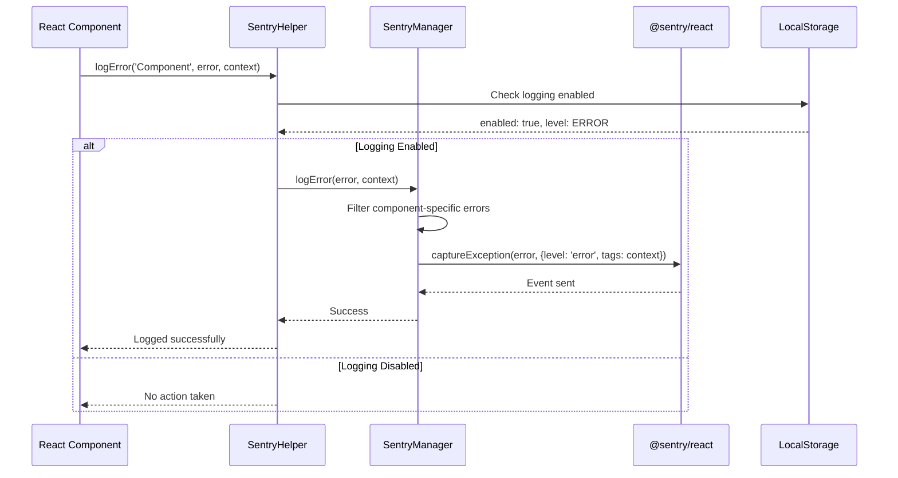
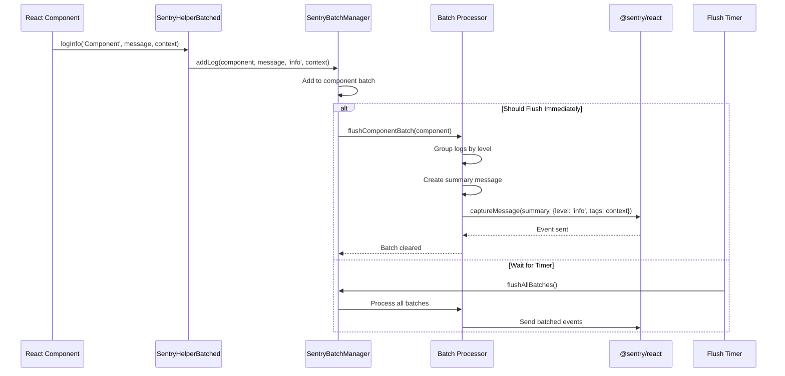

<!-- @format -->

# Sentry Architecture Diagrams

## Overview

This document provides detailed diagrams for the Sentry logging system implementation in the HotLeagueWall project, covering both single message and batch message architectures.

## 1. Single Message Sentry Architecture

```mermaid
graph TB
    subgraph "Application Layer"
        A[React Component] --> B[useSentryHelper Hook]
        A --> C[useSentryHelperBatched Hook]
        A --> D[Direct SentryManager Usage]
    end

    subgraph "Sentry Helper Layer"
        B --> E[SentryHelper]
        C --> F[SentryHelperBatched]
        D --> G[SentryManager]
    end

    subgraph "Sentry Core Layer"
        E --> H[SentryManager Instance]
        F --> I[SentryBatchManager]
        G --> H
        H --> J[@sentry/react]
    end

    subgraph "Configuration Layer"
        K[LocalStorage Config] --> E
        K --> F
        K --> G
        L[Component Config] --> E
        L --> F
        L --> G
    end

    subgraph "Sentry Service"
        J --> M[Sentry Dashboard]
        J --> N[Error Tracking]
        J --> O[Performance Monitoring]
    end

    style A fill:#e1f5fe
    style E fill:#f3e5f5
    style F fill:#f3e5f5
    style G fill:#f3e5f5
    style J fill:#fff3e0
    style M fill:#e8f5e8
```

### Single Message Flow



## 2. Batch Message Sentry Architecture

```mermaid
graph TB
    subgraph "Application Layer"
        A1[React Component] --> B1[useSentryHelperBatched Hook]
        A1 --> C1[Direct Batch Manager Usage]
    end

    subgraph "Batch Management Layer"
        B1 --> D1[SentryHelperBatched]
        C1 --> E1[SentryBatchManager]
        D1 --> E1
    end

    subgraph "Batch Processing"
        E1 --> F1[Component Batch Map]
        F1 --> G1[Batch Queue]
        G1 --> H1[Flush Timer]
        H1 --> I1[Batch Processor]
    end

    subgraph "Sentry Integration"
        I1 --> J1[Group by Level]
        J1 --> K1[Create Summary]
        K1 --> L1[Send to Sentry]
        L1 --> M1[@sentry/react]
    end

    subgraph "Configuration"
        N1[Batch Config] --> E1
        O1[Flush Interval] --> H1
        P1[Max Batch Size] --> G1
    end

    subgraph "Sentry Service"
        M1 --> Q1[Sentry Dashboard]
        M1 --> R1[Batched Events]
        M1 --> S1[Performance Data]
    end

    style A1 fill:#e1f5fe
    style D1 fill:#f3e5f5
    style E1 fill:#f3e5f5
    style I1 fill:#fff3e0
    style M1 fill:#fff3e0
    style Q1 fill:#e8f5e8
```

### Batch Message Flow



## 3. Component-Level Architecture

```mermaid
graph LR
    subgraph "Component A"
        A1[Component A] --> A2[useSentryHelper]
        A2 --> A3[SentryManager A]
    end

    subgraph "Component B"
        B1[Component B] --> B2[useSentryHelperBatched]
        B2 --> B3[SentryBatchManager]
    end

    subgraph "Component C"
        C1[Component C] --> C2[Direct SentryManager]
        C2 --> C3[SentryManager C]
    end

    subgraph "Shared Configuration"
        D1[Global Config] --> A3
        D1 --> B3
        D1 --> C3
        D2[LocalStorage] --> A3
        D2 --> B3
        D2 --> C3
    end

    subgraph "Sentry Service"
        A3 --> E1[@sentry/react]
        B3 --> E1
        C3 --> E1
        E1 --> F1[Sentry Dashboard]
    end

    style A1 fill:#e1f5fe
    style B1 fill:#e1f5fe
    style C1 fill:#e1f5fe
    style A3 fill:#f3e5f5
    style B3 fill:#f3e5f5
    style C3 fill:#f3e5f5
    style E1 fill:#fff3e0
```

## 4. Buffer Overflow Prevention Architecture

```mermaid
graph TB
    subgraph "Event Generation"
        A[Component Logs] --> B[Event Filter]
        B --> C[Rate Limiter]
    end

    subgraph "Buffer Management"
        C --> D[Sentry Buffer]
        D --> E[Buffer Monitor]
        E --> F[Overflow Detector]
    end

    subgraph "Overflow Handling"
        F --> G[Buffer Full Check]
        G --> H[Clear Buffer]
        G --> I[Continue]
        H --> J[Flush Events]
        J --> K[Reset Buffer]
    end

    subgraph "Configuration"
        L[Max Breadcrumbs: 50] --> D
        M[Sample Rate: 10%] --> C
        N[Flush Interval: 30s] --> E
    end

    subgraph "Sentry Service"
        I --> O[@sentry/react]
        J --> O
        O --> P[Sentry Dashboard]
    end

    style A fill:#e1f5fe
    style D fill:#fff3e0
    style F fill:#ffebee
    style H fill:#ffebee
    style O fill:#fff3e0
```

## 5. Workflow Tracking Architecture

```mermaid
graph TB
    subgraph "Workflow Lifecycle"
        A[Start Workflow] --> B[Workflow State]
        B --> C[Update Workflow]
        C --> D[Complete Workflow]
    end

    subgraph "Workflow Manager"
        B --> E[Workflow Config]
        C --> F[State Tracking]
        D --> G[Duration Calculation]
    end

    subgraph "Sentry Integration"
        E --> H[SentryManager]
        F --> H
        G --> H
        H --> I[@sentry/react]
    end

    subgraph "Performance Tracking"
        J[Track Performance] --> K[Start Timer]
        K --> L[Execute Operation]
        L --> M[End Timer]
        M --> N[Log Duration]
        N --> H
    end

    subgraph "Sentry Service"
        I --> O[Sentry Dashboard]
        I --> P[Workflow Analytics]
        I --> Q[Performance Metrics]
    end

    style A fill:#e1f5fe
    style E fill:#f3e5f5
    style H fill:#f3e5f5
    style I fill:#fff3e0
    style O fill:#e8f5e8
```

## 6. Configuration Management Architecture

```mermaid
graph TB
    subgraph "Configuration Sources"
        A[Global Config] --> D[Configuration Manager]
        B[Component Config] --> D
        C[LocalStorage Config] --> D
    end

    subgraph "Configuration Priority"
        D --> E[Priority Resolver]
        E --> F[Component LocalStorage]
        E --> G[Component Config]
        E --> H[Global LocalStorage]
        E --> I[Default Config]
    end

    subgraph "Configuration Application"
        F --> J[SentryManager]
        G --> J
        H --> J
        I --> J
        J --> K[@sentry/react]
    end

    subgraph "Dynamic Updates"
        L[Configuration Change] --> M[Refresh Config]
        M --> N[Update SentryManager]
        N --> J
    end

    subgraph "Sentry Service"
        K --> O[Sentry Dashboard]
        K --> P[Configuration Logs]
    end

    style A fill:#e1f5fe
    style B fill:#e1f5fe
    style C fill:#e1f5fe
    style D fill:#f3e5f5
    style J fill:#f3e5f5
    style K fill:#fff3e0
```

## 7. Error Handling and Recovery

```mermaid
graph TB
    subgraph "Error Detection"
        A[Error Occurs] --> B[Error Filter]
        B --> C[Component Check]
        C --> D[Level Check]
    end

    subgraph "Error Processing"
        D --> E[Logging Enabled Check]
        E --> F[Process Error]
        E --> G[Skip Logging]
        F --> H[Add Context]
        H --> I[Send to Sentry]
    end

    subgraph "Recovery Mechanisms"
        I --> J[Success Check]
        J --> K[Log Success]
        J --> L[Retry Logic]
        L --> M[Fallback Handler]
        M --> N[Console Log]
    end

    subgraph "Buffer Management"
        O[Buffer Overflow] --> P[Detect Overflow]
        P --> Q[Clear Buffer]
        Q --> R[Flush Events]
        R --> S[Reset State]
    end

    subgraph "Sentry Service"
        I --> T[@sentry/react]
        N --> T
        T --> U[Sentry Dashboard]
    end

    style A fill:#ffebee
    style F fill:#f3e5f5
    style I fill:#f3e5f5
    style O fill:#ffebee
    style T fill:#fff3e0
```

## 8. Performance Monitoring Architecture

```mermaid
graph TB
    subgraph "Performance Tracking"
        A[Track Performance] --> B[Start Timer]
        B --> C[Execute Operation]
        C --> D[End Timer]
        D --> E[Calculate Duration]
    end

    subgraph "Performance Analysis"
        E --> F[Duration Check]
        F --> G[Threshold Exceeded Check]
        G --> H[Log Warning]
        G --> I[Log Info]
    end

    subgraph "Performance Reporting"
        H --> J[SentryManager]
        I --> J
        J --> K[@sentry/react]
    end

    subgraph "Performance Metrics"
        K --> L[Performance Dashboard]
        K --> M[Duration Analytics]
        K --> N[Threshold Alerts]
    end

    subgraph "Configuration"
        O[Performance Thresholds] --> F
        P[Enable Performance Tracking] --> A
    end

    style A fill:#e1f5fe
    style E fill:#f3e5f5
    style H fill:#ffebee
    style J fill:#f3e5f5
    style K fill:#fff3e0
```

## Key Features Summary

### Single Message Features:

-   ✅ Direct Sentry integration
-   ✅ Component-specific filtering
-   ✅ Real-time error reporting
-   ✅ Console method override
-   ✅ Buffer overflow prevention
-   ✅ Rate limiting (10% sample rate)
-   ✅ LocalStorage configuration

### Batch Message Features:

-   ✅ Automatic batching by component
-   ✅ Configurable flush intervals (5s default)
-   ✅ Maximum batch size limits (50 default)
-   ✅ Priority-based flushing (errors/warnings immediate)
-   ✅ Batch summarization and grouping
-   ✅ Performance optimization
-   ✅ Manual flush capabilities
-   ✅ Batch statistics tracking

### Common Features:

-   ✅ Workflow tracking
-   ✅ Performance monitoring
-   ✅ Configuration management
-   ✅ Error recovery mechanisms
-   ✅ LocalStorage persistence
-   ✅ Component isolation
-   ✅ Log level hierarchy
-   ✅ Context preservation

## Usage Patterns

### Single Message Usage:

```typescript
// Direct usage
sentryManager.logError('Error message', { context: 'data' });

// Hook usage
const { logError } = useSentryHelper({ componentName: 'MyComponent' });
logError('Error message', { context: 'data' });
```

### Batch Message Usage:

```typescript
// Hook usage
const { logInfo } = useSentryHelperBatched({ componentName: 'MyComponent' });
logInfo('Info message', { context: 'data' });

// Direct batch manager
addBatchedLog('MyComponent', 'Message', 'info', { context: 'data' });
```

This architecture provides a comprehensive logging solution that balances performance, reliability, and ease of use while preventing buffer overflow issues and providing detailed error tracking capabilities.
