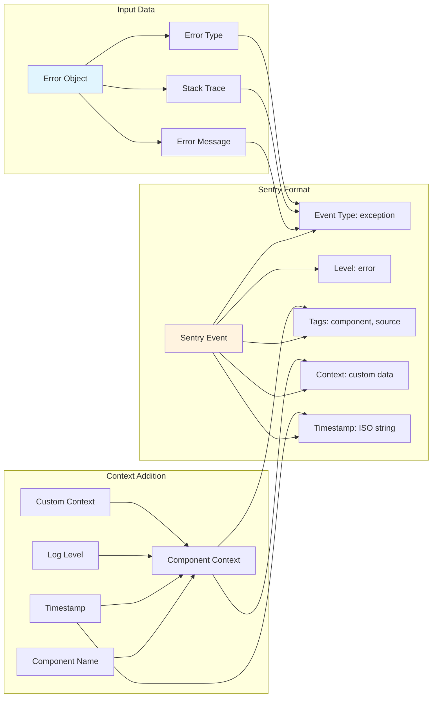
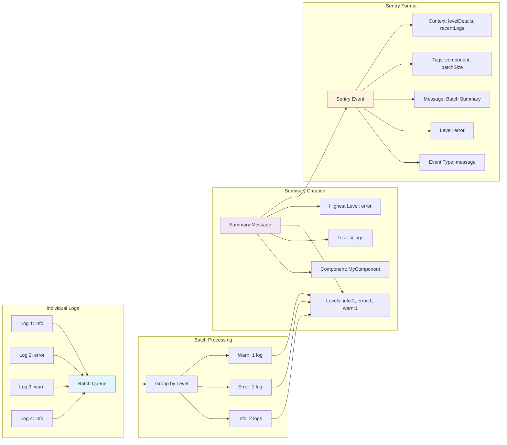
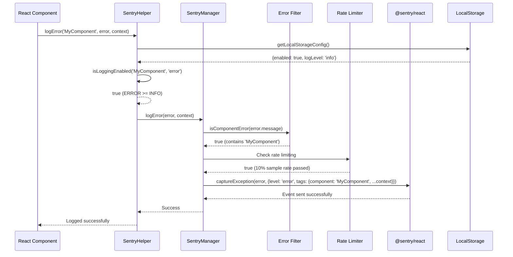
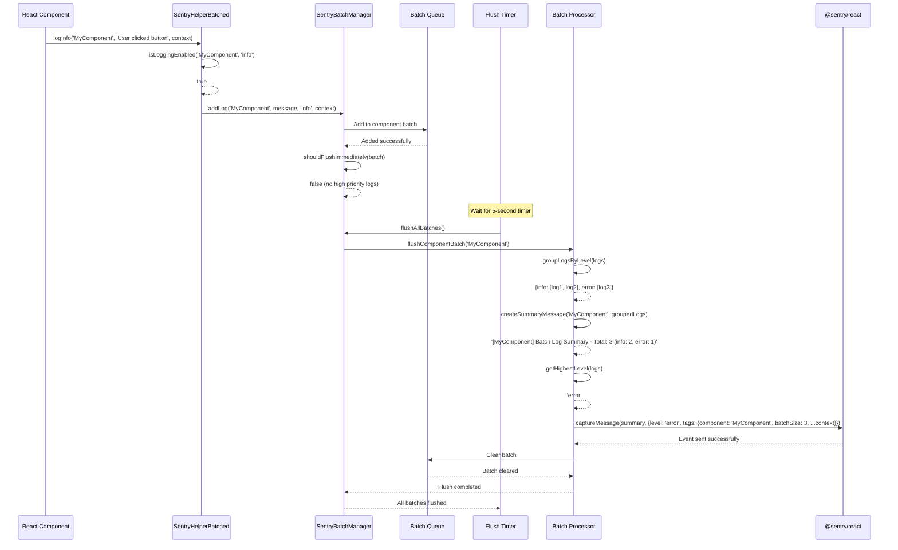
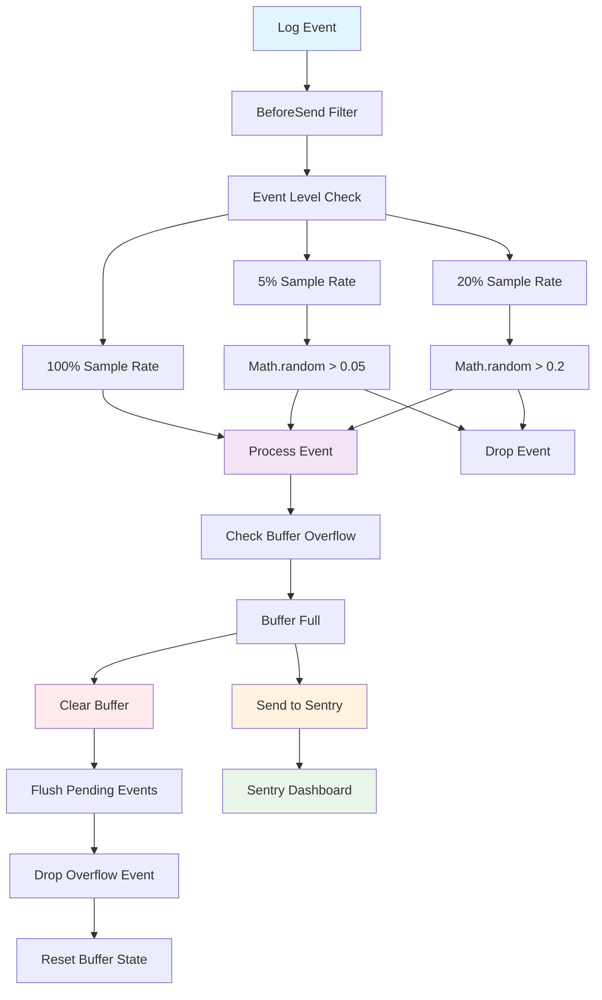
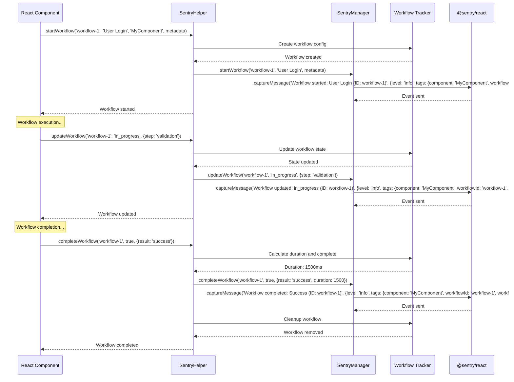
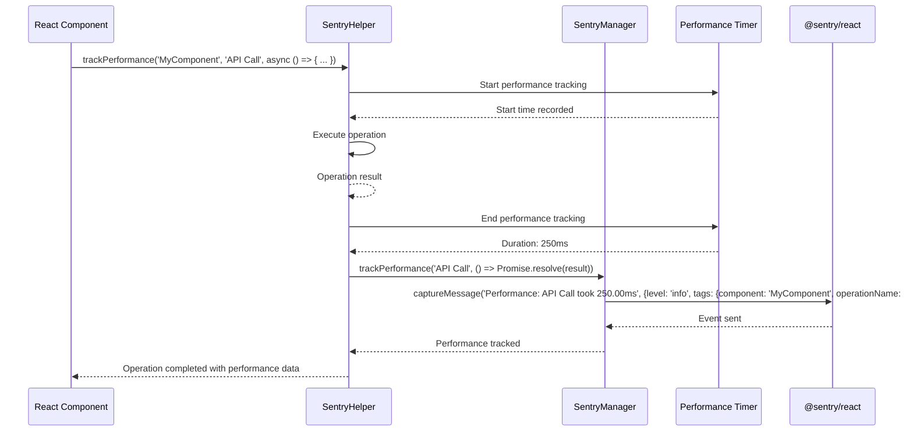
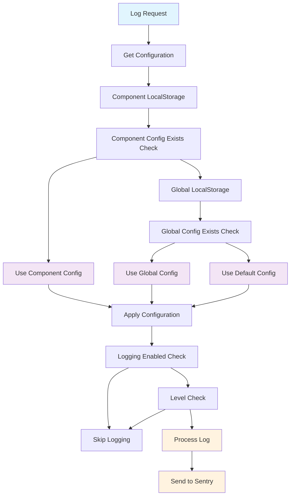
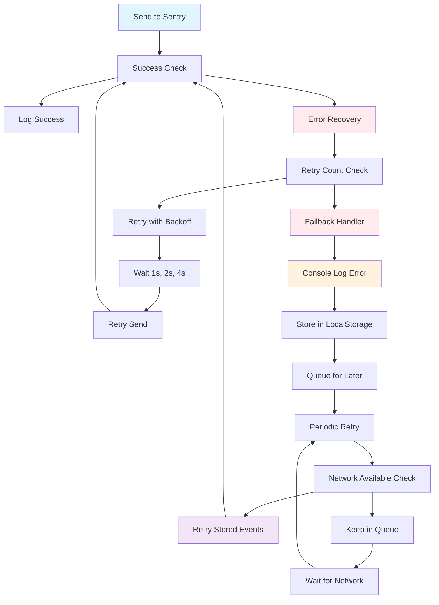

<!-- @format -->

# Sentry Message Flow Diagrams

## Overview

This document provides detailed message flow diagrams showing how individual messages and batched messages are processed through the Sentry system, including data transformations, filtering, and delivery mechanisms.

## 1. Single Message Processing Flow

```mermaid
graph TD
    A[React Component] --> B[logError/logInfo/logWarning]
    B --> C[Check Logging Enabled]
    C --> D[Skip Processing]
    C --> E[Create Log Entry]
    E --> F[Add Component Context]
    F --> G[Add Timestamp]
    G --> H[Add Log Level]
    H --> I[Add Custom Context]
    I --> J[Filter Component-Specific]
    J --> K[Component Match]
    K --> L[Skip - Not Component Error]
    K --> M[Rate Limiting Check]
    M --> N[Pass Rate Limit]
    N --> O[Drop Event - Rate Limited]
    N --> P[Send to Sentry]
    P --> Q[@sentry/react]
    Q --> R[Sentry Dashboard]

    style A fill:#e1f5fe
    style E fill:#f3e5f5
    style P fill:#fff3e0
    style Q fill:#fff3e0
    style R fill:#e8f5e8
```

### Single Message Data Transformation



## 2. Batch Message Processing Flow

```mermaid
graph TD
    A[React Component] --> B[logInfo/logError/logWarning]
    B --> C[Check Logging Enabled]
    C --> D[Skip Processing]
    C --> E[Add to Component Batch]
    E --> F[Store in Batch Queue]
    F --> G[Add to Component Map]
    G --> H[Should Flush Immediately]
    H --> I[Wait for Timer]
    H --> J[Trigger Immediate Flush]
    I --> K[Timer Event - 5s]
    K --> L[Flush All Batches]
    J --> M[Process Component Batch]
    L --> M
    M --> N[Group Logs by Level]
    N --> O[Create Summary Message]
    O --> P[Calculate Highest Level]
    P --> Q[Create Batch Context]
    Q --> R[Send Summary to Sentry]
    R --> S[@sentry/react]
    S --> T[Sentry Dashboard]

    style A fill:#e1f5fe
    style E fill:#f3e5f5
    style M fill:#fff3e0
    style S fill:#fff3e0
    style T fill:#e8f5e8
```

### Batch Message Data Transformation



## 3. Detailed Single Message Processing



## 4. Detailed Batch Message Processing



## 5. Buffer Overflow Prevention Flow



## 6. Workflow Tracking Message Flow



## 7. Performance Tracking Message Flow



## 8. Configuration Priority Flow



## 9. Error Recovery and Fallback Flow



## 10. Message Data Structure Comparison

### Single Message Structure

```json
{
    "type": "exception",
    "level": "error",
    "message": "User authentication failed",
    "timestamp": "2024-01-15T10:30:45.123Z",
    "tags": {
        "component": "MyComponent",
        "source": "SentryManager",
        "userId": "12345"
    },
    "contexts": {
        "component": {
            "name": "MyComponent"
        },
        "custom": {
            "operation": "login",
            "attempt": 3
        }
    },
    "exception": {
        "type": "AuthenticationError",
        "value": "Invalid credentials",
        "stacktrace": "..."
    }
}
```

### Batch Message Structure

```json
{
    "type": "message",
    "level": "error",
    "message": "[MyComponent] Batch Log Summary - Total: 5 (info: 2, error: 1, warn: 2)",
    "timestamp": "2024-01-15T10:30:45.123Z",
    "tags": {
        "component": "MyComponent",
        "batchSize": 5,
        "source": "SentryBatchManager"
    },
    "contexts": {
        "batch": {
            "batchSize": 5,
            "timestamp": 1705315845123,
            "levels": {
                "info": {
                    "count": 2,
                    "messages": [
                        { "message": "User clicked button", "timestamp": 1705315844000 },
                        { "message": "API call started", "timestamp": 1705315844100 }
                    ]
                },
                "error": {
                    "count": 1,
                    "messages": [{ "message": "API call failed", "timestamp": 1705315844200 }]
                },
                "warn": {
                    "count": 2,
                    "messages": [
                        { "message": "Slow response time", "timestamp": 1705315844300 },
                        { "message": "Retry attempt", "timestamp": 1705315844400 }
                    ]
                }
            },
            "recentLogs": [
                {
                    "level": "info",
                    "message": "User clicked button",
                    "timestamp": 1705315844000
                },
                {
                    "level": "info",
                    "message": "API call started",
                    "timestamp": 1705315844100
                },
                {
                    "level": "error",
                    "message": "API call failed",
                    "timestamp": 1705315844200
                },
                {
                    "level": "warn",
                    "message": "Slow response time",
                    "timestamp": 1705315844300
                },
                {
                    "level": "warn",
                    "message": "Retry attempt",
                    "timestamp": 1705315844400
                }
            ]
        }
    }
}
```

## Key Differences Summary

| Aspect             | Single Message         | Batch Message         |
| ------------------ | ---------------------- | --------------------- |
| **Processing**     | Immediate              | Buffered              |
| **Delivery**       | Real-time              | Periodic (5s)         |
| **Data Structure** | Individual event       | Summarized batch      |
| **Performance**    | Higher overhead        | Optimized             |
| **Context**        | Full context per event | Aggregated context    |
| **Error Handling** | Individual retry       | Batch retry           |
| **Memory Usage**   | Lower                  | Higher (temporary)    |
| **Network Usage**  | More requests          | Fewer requests        |
| **Use Case**       | Critical errors        | High-volume logging   |
| **Configuration**  | Component-specific     | Global batch settings |

This comprehensive flow analysis shows how the Sentry system handles both individual and batched messages, providing flexibility for different logging requirements while maintaining performance and reliability.
